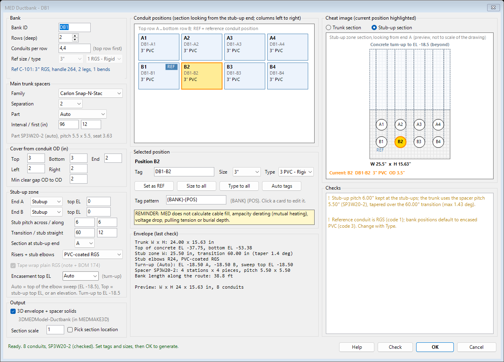
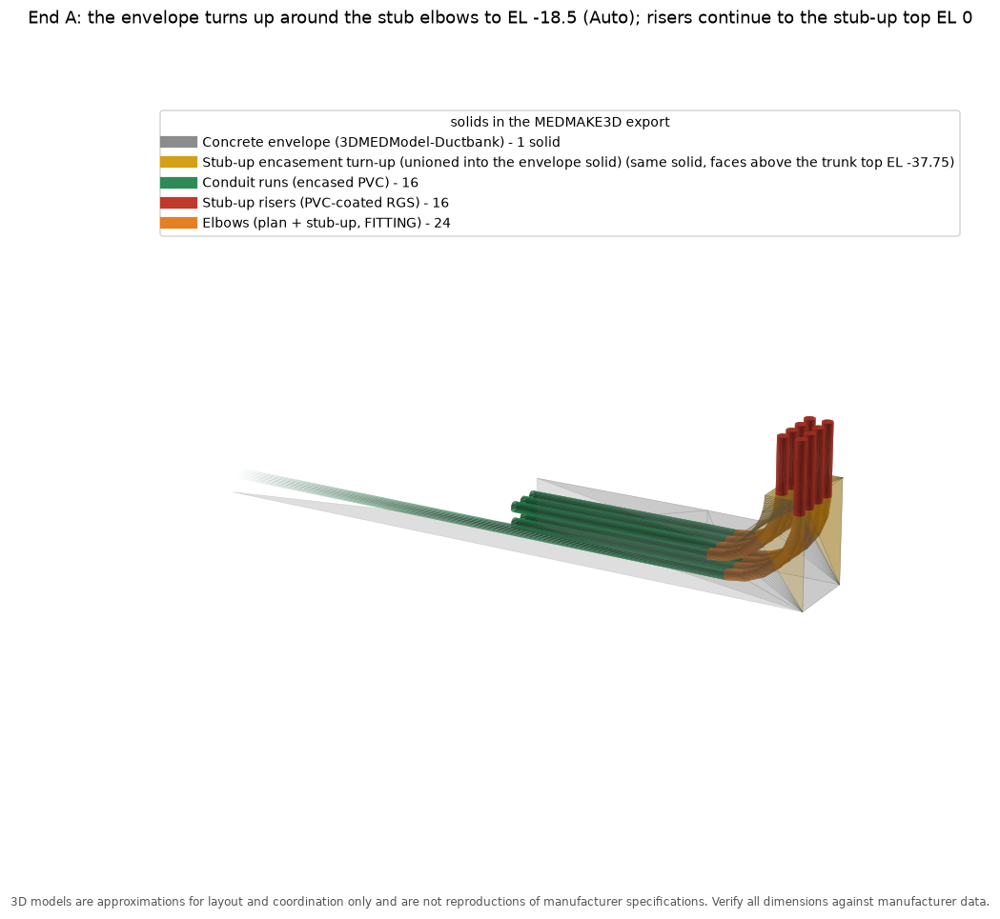

# Ductbank (DUCTBANK)

`DUCTBANK` (`Support\MEDDuctbank.lsp`, loaded by MEDCore) turns one routed MED conduit, or a plain 3D polyline route, into a full encased ductbank. You get plan conduits for every position, plan elbows and stub-up elbows, risers, spacer stations, the concrete envelope with its stub-up turn-ups, sections 1-1 and 2-2, and BOM records for all of it. `DBEDIT` reopens a bank and rebuilds it in place. It can also build 3D envelope and spacer solids for `MEDMAKE3D`.

Design background: [design/ductbank-routing.md](design/ductbank-routing.md). Build notes: [design/ductbank-mvp-notes.md](design/ductbank-mvp-notes.md).

## Commands

| Command | What it does |
| --- | --- |
| `DUCTBANK` | Pick the reference (a MED conduit or a plain 3D polyline route), then the **Ductbank dialog** opens. Set tags and sizes, then click OK to generate. |
| `-DUCTBANK` | The same command at the command line (standard AutoCAD dash convention). `DUCTBANK` also falls back to this when `MED-DotNet.dll` is not loaded, or when there is no UI (accoreconsole). |
| `DBEDIT` | Pick any part of a bank. The dialog reopens with that bank's stored settings; **Rebuild** erases the old bank (2D and 3D) and regenerates it in place with the same bank ID. |
| `-DBEDIT` | The same at the command line (the `-DUCTBANK` prompts, then the Tag/Size/Type/Options loop). |
| `DBLIST` | Lists a bank: positions, tags, sizes, lengths, elbows, stations, stub-up material, stub-up encasement, reference route and 3D solid count. |
| `DBDELETE` | Erases a bank (including its 3D solids) and restores the reference route: a MED conduit gets its MED data back, a plain polyline goes back to its layer with no data. |
| `DBSEED` | Adds the ductbank catalog codes to `MEDType`. It is idempotent and only adds missing codes (`Data\seed\ductbank_medtype.csv`). |

## Workflow

1. Draw the route as a normal MED conduit (`CONDUIT`), or as a plain `3DPOLY` (an `LWPOLYLINE` or `LINE` at an elevation also works). Vertical legs at either end mean stub-ups.
2. Run `DUCTBANK` and pick it. For a plain route (no MED data), set the reference conduit size and type (see [Plain 3D polyline reference](#plain-3d-polyline-reference)).
3. In the dialog, click each position card and set its **Tag**, **Size** and **Type**. **Size to all** and **Type to all** copy the current values to every position, and **Auto tags** re-applies the tag pattern (`{BANK}-{POS}`).
4. Click **Check** to re-run the solver and refresh the envelope and checks. Click **OK** to generate. OK is refused while any check shows an error (X).

The defaults handle everything else:

| Setting | Default |
| --- | --- |
| Spacer | Carlon Snap-N-Stac, 2" separation, part sized to the largest conduit |
| Spacer interval | 8 ft (first station 12" in) |
| Cover | 3" top and bottom, 2" sides |
| Stub-up pitch | 5.5" |
| Transition | 60" |
| Stub-up material | PVC-coated RGS |
| Stub-up encasement | Auto (top of the elbow sweep) |
| 3D solids | On |

## Dialog layout

- **Left column:**
  - **Bank:** ID, rows, conduits per row (for example `4,4`), **Ref size / type** (enabled for a plain route only) and the reference info.
  - **Main trunk spacers:** family, separation, part (Auto or a catalog part), interval and first-station offset, plus the solved pitch and seat.
  - **Cover from conduit OD:** top, bottom, end, left, right and minimum clear gap.
  - **Stub-up zone:** End A / End B (Stubup / Open) and their top elevations, stub pitch across and along, transition and stub straight, section end, **Risers + stub elbows** material (PVC-coated RGS or plain RGS), the **Tape wrap** box for plain RGS and **Encasement top EL** (Auto, Top or an elevation; the hint shows the elbow sweep top EL).
  - **Output:** 3D envelope and spacer solids, section scale, and **Pick section location** (otherwise the sections are placed automatically to the right of the bank).
- **Middle column:**
  - **Position grid:** one card per position, top row A first, columns left to right looking from the stub-up end. REF marks the reference position; the selected card is highlighted.
  - **Selected-position editor:** Tag, Size, Type, **Set as REF**, **Size to all**, **Type to all**, **Auto tags** and the tag pattern.
  - **Calc reminder:** MED does not calculate cable fill, ampacity derating, voltage drop, pulling tension or burial depth.
  - **Envelope (last check):** trunk W x H, elevations, stub zone, elbows, spacers and bank length.
- **Right column:**
  - **Cheat image:** trunk or stub-up section with the envelope, the spacer pieces (green) and each conduit at its OD. The current conduit is gold. The stub-up section also shows the concrete turn-up beyond (light hatch, dashed outline, risers dashed) up to the encasement top.
  - **Checks:** X = error (blocks OK), ! = flag (review), i = note.

## Stub-up encasement (turn-up)

At each stub-up end, the concrete turns up around the stub elbows and risers. It is part of the bank, not a separate pour:

- **Encasement top EL** (dialog, Stub-up zone) or `-DUCTBANK` Options > ENcasement:
  - **Auto** (default): the top of the highest stub elbow sweep (the end of the R24 / R36 bend). For the 3" sample that is EL -18.5.
  - **Top**: the stub-up top EL (grade).
  - **an elevation**: any value up to the stub-up top EL. Higher values are clamped to the top EL. A value below the sweep top is accepted with a flag (the elbow tops are not encased). A value at or below the trunk top means no turn-up (flag).
- **3D:** the turn-up is modelled as a profile in the vertical plane of the end leg and extruded across the stub zone width. The profile runs from the end face (stub OD + end cover) back along the elbow sweep (inner elbow radius minus OD/2 and cover) and up to the encasement top. It is unioned into the `3DMEDModel-Ductbank` envelope solid, so the bank still has one envelope solid. `MEDMAKE3D` exports it with the envelope.
- **Plan:** a closed outline on `MED_DBENVELOPE` at the turn-up top elevation, with the note `CONCRETE TURN-UP TO EL x`.
- **Section 1-1 (stub-up section):** a hidden-line outline of the turn-up beyond, the note `CONCRETE TURN-UP BEYOND, TOP EL x`, and the turn-up EL in the subtitle.
- **Stored:** `ENCH` (the setting) and `ENCZA` / `ENCZB` (the solved elevations) in the bank record. `DBEDIT` reuses them.

## Plain 3D polyline reference

The reference can be a plain `3DPOLY`, `LWPOLYLINE` (with elevation) or `LINE` that has no MED data:

- The dialog enables **Ref size / type** in the Bank box. `-DUCTBANK` asks *Reference conduit trade size* and *Reference conduit type code* first. The default is the last value used, otherwise `_DBKREFSIZE` (4") and `_DBKCONCODE` (3 = PVC).
- Changing the reference size / type also changes every position still at the old default (and the REF position).
- The route is moved to `MED_DBREF` and tagged `REFPLAIN=1`. `DBDELETE` puts it back on its original layer with no data.
- MED conduit references work as before (their size and type come from the MED data).

## DBEDIT (rebuild in place)

1. Run `DBEDIT` and pick any member of the bank (conduit, elbow, envelope, text, 3D solid...).
2. The dialog opens pre-filled from the bank record: rows and counts, REF position, tags, sizes, types, spacer separation and part, cover, interval, stub-up ends and top ELs, stub pitch, material and wrap, encasement, 3D option, tag pattern, section end and scale. The title shows *(DBEDIT: rebuild in place)*, the bank ID is read-only and OK reads **Rebuild**.
3. **Rebuild** erases every old member (plan entities, sections, notes, 3D envelope and spacer solids) and regenerates the bank from the reference route on `MED_DBREF` with the same bank ID. The sections are drawn at the same place.

Notes:

- If you edited the reference route on `MED_DBREF` (moved it, stretched a vertex), DBEDIT rebuilds on the edited route.
- `-DBEDIT` does the same at the command line.
- Your session settings (covers, interval and so on) are put back after DBEDIT. The bank's own settings only apply to that bank.
- Banks built before this version have no position records. DBEDIT reads their positions from the conduits' MED data, and the defaults for the new settings.

## Stub-up material and wrap

Risers and stub-up elbows default to **PVC-coated RGS**:

- conduit code 2
- elbows 160-165
- adapter 170 to the encased PVC
- PVC-coated RGS coupling 173

For **plain RGS**, use the dialog or `-DUCTBANK` Options > STUbmaterial > Rgs. You get:

- conduit code 1
- RGS elbows 89/90/91/166 (90 deg) or 167-169 (45 deg)
- adapter 170
- coupling 8

The **Tape wrap** option (on by default) adds code 174, *Corrosion Protection Tape Wrap (Plain RGS Stub-Up)*, at each stub-up, puts a `WRAP` note at the stub and adds a flag to the checks.

Plan bends in the trunk are always PVC-coated RGS elbows.

## 3D model layer

When **3D envelope + spacer solids** is on (`_DBKMODEL3D 1`), DUCTBANK models:

- the concrete envelope as one solid, with the stub-up turn-ups unioned in
- each spacer station as one solid (pieces unioned, conduit seats subtracted)

They go on `3DMEDModel-Ductbank`. The layer is non-plotting, color 8. `MEDMAKE3D` picks them up automatically (see [3d.md](3d.md#3d-model-layers-3dmedmodel-)). `DBDELETE` erases them with the bank.

> 3D models are approximations for layout and coordination only and are not reproductions of manufacturer specifications. Verify all dimensions against manufacturer data.

## Settings (med.spc)

Every variable has a default in code. `med.spc` only overrides it.

| Variable | Default | Meaning |
| --- | --- | --- |
| `_DBKUSEDIALOG` | 1 | 0 makes `DUCTBANK` always use the command line |
| `_DBKENCASE` | `"Auto"` | Stub-up encasement top: `"Auto"` (top of the elbow sweep), `"Top"` (stub-up top EL) or an elevation |
| `_DBKREFSIZE` | 4.0 | Plain route reference: default reference conduit size (the last value used wins) |
| `_DBKRISERCODE` | 2 | Stub-up riser and elbow material: 2 = PVC-coated RGS, 1 = plain RGS |
| `_DBKSTUBWRAP` | 1 | Tape wrap (code 174) for plain RGS stub-ups |
| `_DBKMODEL3D` | 1 | Build 3D envelope and spacer solids |
| `_DBKSPTHICK` | 2.0 | Spacer solid thickness along the run (in) |
| `_MED3DMODELPREFIX` | `3DMEDModel-` | Layer prefix that MEDMAKE3D pulls into the 3D export |

## MEDMAKE3D and the bank

`MEDMAKE3D` turns the bank into 3D as follows:

- **Plan runs and risers:** conduit solids (risers at the stub-up material OD).
- **Elbows:** each broken-segment elbow becomes a swept solid at its radius, stamped as a FITTING with its elbow description.
- **Envelope (with the stub-up turn-ups) and spacer solids:** copied from the `3DMEDModel-` layers.

The summary shows `Ductbank elbow:` and `3D model layer:` lines.

## Testing

`tests\autocad\MEDDuctbankTest.ps1` runs headless (accoreconsole) on a copy of `Samples\ConduitDuctbankStart.dwg`:

| Switch | What it adds |
| --- | --- |
| (none) | 3" bank as drawn, default encasement (turn-up to EL -18.5 at both ends) |
| `-Size 4` | 4" variant, then `DBDELETE` |
| `-Rgs` | plain RGS stub-ups, wrapped |
| `-Enc -30` / `-Enc Top` | custom encasement top |
| `-Plain` | reference = plain 3DPOLY made from the sample reference's vertices (size 3, type 3) |
| `-Edit` | after the checks: moves the `MED_DBREF` route 12" east, `-DBEDIT` retags A1 to MV-101 and sets B2 to 4", then checks counts, handles, orphans, duplicate solids and the edited route |
