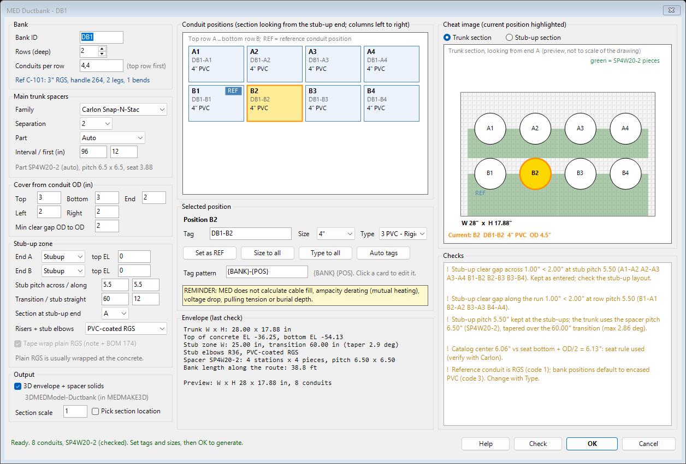

# Ductbank (DUCTBANK)

`DUCTBANK` (`Support\MEDDuctbank.lsp`, loaded by MEDCore) turns one routed MED conduit into a full encased ductbank. You get plan conduits for every position, plan elbows and stub-up elbows, risers, spacer stations, the concrete envelope, sections 1-1 and 2-2, and BOM records for all of it. It can also build 3D envelope and spacer solids for `MEDMAKE3D`.

Design background: [design/ductbank-routing.md](design/ductbank-routing.md). Build notes: [design/ductbank-mvp-notes.md](design/ductbank-mvp-notes.md).

## Commands

| Command | What it does |
| --- | --- |
| `DUCTBANK` | Pick the reference conduit, then the **Ductbank dialog** opens. Set tags and sizes, then click OK to generate. |
| `-DUCTBANK` | The same command at the command line (standard AutoCAD dash convention). `DUCTBANK` also falls back to this when `MED-DotNet.dll` is not loaded, or when there is no UI (accoreconsole). |
| `DBLIST` | Lists a bank: positions, tags, sizes, lengths, elbows, stations, stub-up material and 3D solid count. |
| `DBDELETE` | Erases a bank (including its 3D solids) and restores the reference conduit. |
| `DBSEED` | Adds the ductbank catalog codes to `MEDType`. It is idempotent and only adds missing codes (`Data\seed\ductbank_medtype.csv`). |

## Workflow

1. Draw the route as a normal MED conduit (`CONDUIT`). Vertical legs at either end mean stub-ups.
2. Run `DUCTBANK` and pick that conduit.
3. In the dialog, click each position card and set its **Tag**, **Size** and **Type**. **Size to all** and **Type to all** copy the current values to every position, and **Auto tags** re-applies the tag pattern (`{BANK}-{POS}`).
4. Click **Check** to re-run the solver and refresh the envelope and checks. Click **OK** to generate. OK is refused while any check shows an error (X).

The defaults handle everything else:

| Setting | Default |
| --- | --- |
| Spacer | Carlon Snap-N-Stac, 2" separation, part sized to the largest conduit |
| Spacer interval | 8 ft (first station 12" in) |
| Cover | 3" top and bottom, 2" sides |
| Stub-up pitch | 5.5" |
| Transition | 60" |
| Stub-up material | PVC-coated RGS |
| 3D solids | On |

## Dialog layout

- **Left column:**
  - **Bank:** ID, rows, conduits per row (for example `4,4`) and the reference info.
  - **Main trunk spacers:** family, separation, part (Auto or a catalog part), interval and first-station offset, plus the solved pitch and seat.
  - **Cover from conduit OD:** top, bottom, end, left, right and minimum clear gap.
  - **Stub-up zone:** End A / End B (Stubup / Open) and their top elevations, stub pitch across and along, transition and stub straight, section end, **Risers + stub elbows** material (PVC-coated RGS or plain RGS) and the **Tape wrap** box for plain RGS.
  - **Output:** 3D envelope and spacer solids, section scale, and **Pick section location** (otherwise the sections are placed automatically to the right of the bank).
- **Middle column:**
  - **Position grid:** one card per position, top row A first, columns left to right looking from the stub-up end. REF marks the reference position; the selected card is highlighted.
  - **Selected-position editor:** Tag, Size, Type, **Set as REF**, **Size to all**, **Type to all**, **Auto tags** and the tag pattern.
  - **Calc reminder:** MED does not calculate cable fill, ampacity derating, voltage drop, pulling tension or burial depth.
  - **Envelope (last check):** trunk W x H, elevations, stub zone, elbows, spacers and bank length.
- **Right column:**
  - **Cheat image:** trunk or stub-up section with the envelope, the spacer pieces (green) and each conduit at its OD. The current conduit is gold.
  - **Checks:** X = error (blocks OK), ! = flag (review), i = note.

## Stub-up material and wrap

Risers and stub-up elbows default to **PVC-coated RGS**:

- conduit code 2
- elbows 160-165
- adapter 170 to the encased PVC
- PVC-coated RGS coupling 173

For **plain RGS**, use the dialog or `-DUCTBANK` Options > STUbmaterial > Rgs. You get:

- conduit code 1
- RGS elbows 89/90/91/166 (90 deg) or 167-169 (45 deg)
- adapter 170
- coupling 8

The **Tape wrap** option (on by default) adds code 174, *Corrosion Protection Tape Wrap (Plain RGS Stub-Up)*, at each stub-up, puts a `WRAP` note at the stub and adds a flag to the checks.

Plan bends in the trunk are always PVC-coated RGS elbows.

## 3D model layer

When **3D envelope + spacer solids** is on (`_DBKMODEL3D 1`), DUCTBANK models:

- the concrete envelope as one solid
- each spacer station as one solid (pieces unioned, conduit seats subtracted)

They go on `3DMEDModel-Ductbank`. The layer is non-plotting, color 8. `MEDMAKE3D` picks them up automatically (see [3d.md](3d.md#3d-model-layers-3dmedmodel-)). `DBDELETE` erases them with the bank.

> 3D models are approximations for layout and coordination only and are not reproductions of manufacturer specifications. Verify all dimensions against manufacturer data.

## Settings (med.spc)

Every variable has a default in code. `med.spc` only overrides it.

| Variable | Default | Meaning |
| --- | --- | --- |
| `_DBKUSEDIALOG` | 1 | 0 makes `DUCTBANK` always use the command line |
| `_DBKRISERCODE` | 2 | Stub-up riser and elbow material: 2 = PVC-coated RGS, 1 = plain RGS |
| `_DBKSTUBWRAP` | 1 | Tape wrap (code 174) for plain RGS stub-ups |
| `_DBKMODEL3D` | 1 | Build 3D envelope and spacer solids |
| `_DBKSPTHICK` | 2.0 | Spacer solid thickness along the run (in) |
| `_MED3DMODELPREFIX` | `3DMEDModel-` | Layer prefix that MEDMAKE3D pulls into the 3D export |

## MEDMAKE3D and the bank

`MEDMAKE3D` turns the bank into 3D as follows:

- **Plan runs and risers:** conduit solids (risers at the stub-up material OD).
- **Elbows:** each broken-segment elbow becomes a swept solid at its radius, stamped as a FITTING with its elbow description.
- **Envelope and spacer solids:** copied from the `3DMEDModel-` layers.

The summary shows `Ductbank elbow:` and `3D model layer:` lines.
